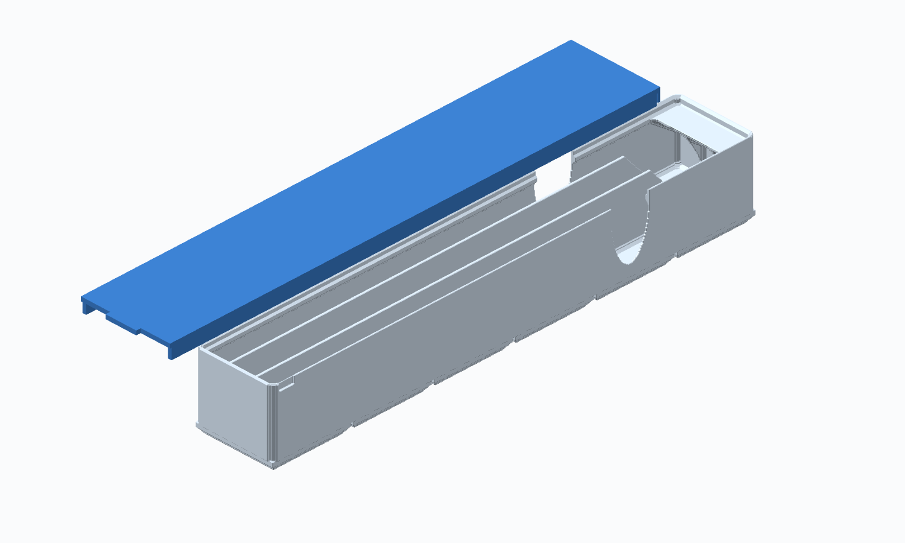

# 3D Printing Projects

A collection of printable designs, CAD source, print settings, and physical test notes.

[](designs/gridfinity/reciprocating-saw-blade-holder/README.md)

*Featured prototype: [Gridfinity reciprocating saw blade holder with sliding lid](designs/gridfinity/reciprocating-saw-blade-holder/README.md). Rendered from the actual V4 STL meshes; physical print validation pending.*

## New here?

Start with our [Quickstart Guide](QUICKSTART.md)
to print a design, suggest an improvement,
or create a new design using AI.

See [Contributing](CONTRIBUTING.md) for
full contribution guidelines.

## Designs

| Project | Category | Status | License |
|---|---|---|---|
| [Reciprocating saw blade holder with sliding lid](designs/gridfinity/reciprocating-saw-blade-holder/) | Gridfinity | **V4 prototype — physical fit test pending** | CC BY-NC-SA 4.0 remix; license confirmed |

## Repository layout

```text
3d-printing/
├── designs/
│   ├── gridfinity/
│   │   └── reciprocating-saw-blade-holder/
│   │       ├── cad/            # Build source and derived inputs
│   │       ├── stl/            # Latest print-ready candidates
│   │       ├── slicer/         # Saved slicer projects, once available
│   │       ├── images/         # STL preview renders and future print photos
│   │       ├── references/     # Original design and attribution
│   │       ├── scripts/        # Mesh verification
│   │       ├── ATTRIBUTION.md
│   │       ├── LICENSE.md
│   │       └── README.md
│   ├── electronics/
│   ├── household/
│   └── tools/
├── .github/workflows/ # Automatic validation and generic manual CAD rebuild
├── scripts/          # Repository-wide STL checks, build runner, and tests
├── BUILDING_DESIGNS.md # How to register a design for CAD rebuilds
├── pyproject.toml      # uv dependency groups for CI and per-design CAD tools
├── uv.lock             # commit after generating on an online machine
├── .python-version     # Python 3.12
├── .gitattributes
├── .gitignore
└── README.md
```

## Getting started

Git is not initialized inside the ZIP. To publish your own new repository:

```bash
git lfs install
git init
git add .
git commit -m "Initial 3D printing repository with saw blade holder V4"
# Create an empty repository on GitHub, then connect it:
git branch -M main
git remote add origin https://github.com/YOUR-USERNAME/3d-printing.git
git push -u origin main
```

STL files use Git LFS, so install Git LFS **before** running `git add .`.

## Automated validation (GitHub Actions)

The workflow [`Validate 3D designs`](.github/workflows/validate-designs.yml) runs automatically on **pushes to `main`**, **pull requests**, and manual dispatch. It checks out the real STL files via Git LFS, installs uv-locked CI mesh-validation dependencies, tests the validator, checks Python syntax, validates every `designs/**/stl/**/*.stl` mesh, and discovers/runs each project's optional `scripts/check_meshes.py`. A failure gives a red CI status; each run includes a Markdown report in Actions and an artifact.

It verifies *watertightness, connectedness, winding and positive volume*. The CI dependencies include **SciPy**, because Trimesh needs a graph backend to count disconnected STL components; installing only `numpy` and `trimesh` causes `ImportError: no graph engines available!`. It does **not** prove the design is printable without supports, properly sized for Gridfinity, or physically fits/locks. After printing, record real-world results in the project's README.

For locally matching the CI checks:

```bash
uv python install
uv lock  # only when creating or updating the lockfile; commit uv.lock
uv sync --locked --no-default-groups --group ci
uv run --no-sync python -m unittest discover -s scripts/tests -v
uv run --no-sync python scripts/validate_stls.py
uv run --no-sync python scripts/run_project_checks.py
```

The second workflow, [`Build designs (manual)`](.github/workflows/build-designs.yml), is a **generic CAD rebuild system**. Run it from the *Actions* tab with `design=all` or the ID of one registered project. Each buildable project declares its Python builder, dependencies, and required STL outputs in `design.json`; the runner rebuilds into separate artifact directories, validates the generated geometry, and uploads the STLs and report without committing anything. See [BUILDING_DESIGNS.md](BUILDING_DESIGNS.md) to add future projects. The existing V4 CAD generation has not been run on GitHub-hosted runners and could need dependency or memory tuning; daily CI still only validates committed outputs.

To make checks mandatory before merging, configure a branch protection rule or repository ruleset requiring **Check STL geometry and Python source**. GitHub Actions must be enabled for the repository. Git LFS storage and bandwidth limits may apply.

## CAD rebuilds

To see registered build targets locally: `uv run --locked --no-default-groups --group ci python scripts/build_designs.py --list`. The new generic builder checks `design.json` manifests automatically in CI; full rebuilds are manual. [Documentation and new-design template](BUILDING_DESIGNS.md).

## Licensing and attribution

**There is intentionally no blanket repository license.** Each design has its own license and attribution, since future designs may have different authors or terms. The first design is a remix of a noncommercial ShareAlike model; see its [attribution](designs/gridfinity/reciprocating-saw-blade-holder/ATTRIBUTION.md) and [license](designs/gridfinity/reciprocating-saw-blade-holder/LICENSE.md).

Do not represent a remix of someone else's design as an original creation. The original creator’s Printables page confirms CC BY-NC-SA **4.0 International**; the remix uses the same license. Commercial exploitation of the remix requires permission beyond the listed CC BY-NC-SA license.

## Dependency management

Python dependencies are managed entirely by **uv** via `pyproject.toml` and `uv.lock` (not pip requirements files). The `ci` dependency group includes NumPy, SciPy (Trimesh graph backend), and Trimesh. Each buildable CAD project can opt into a separate group through its `design.json`. CI uses the `ci` group only; manual CAD builds activate the selected group. See [BUILDING_DESIGNS.md](BUILDING_DESIGNS.md).

If the ZIP does not include `uv.lock`, generate it once on an online machine with `uv lock` and commit it. GitHub Actions can bootstrap the missing lock and provide it as a downloadable artifact, but subsequent runs should use the committed lockfile to ensure repeatability.
